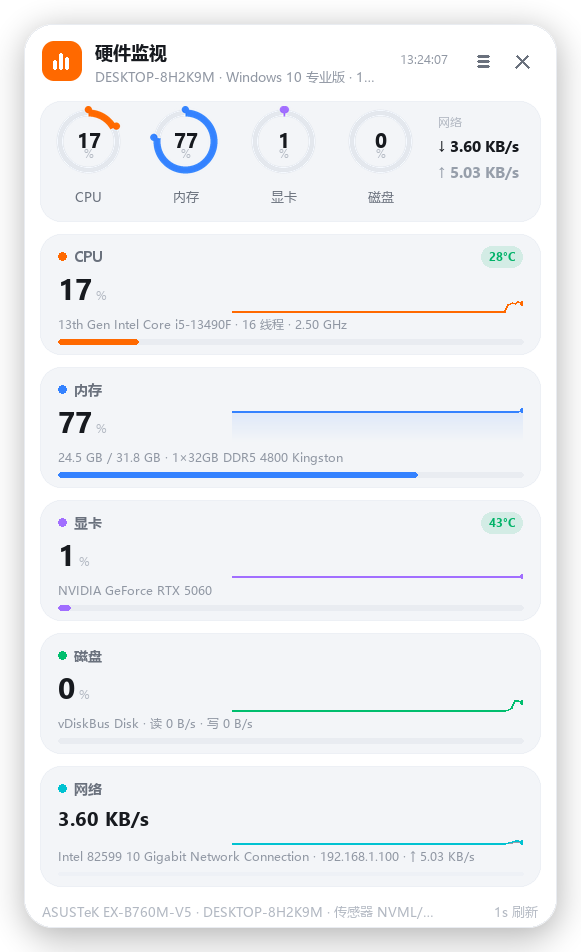
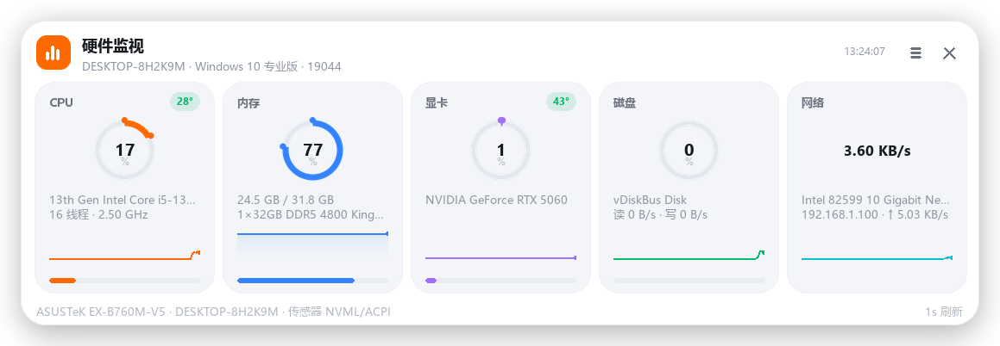

# HwDock · Windows 硬件监视器

[](https://github.com/Evinsong/HwDock/releases)
[](LICENSE)
[](https://www.python.org/)
[](https://www.microsoft.com/windows)

一个常驻桌面的轻量硬件监视器。**一页看完** CPU / 内存 / 显卡 / 磁盘 / 网络的实时占用、
设备型号与温度；拖到屏幕边缘松手就自动缩进去，只留一条细边，鼠标扫过瞬间滑出。

界面采用小米 HyperOS 风格，纯 Win32 分层窗口 + Pillow 离屏渲染，不依赖 Electron / Qt / WebView。

> 截图中的主机名与 IP 为脱敏示例值，硬件型号为真实采集结果。

| 吸附左右边（竖版） | 吸附上下边（横版） |
| --- | --- |
|  |  |

---

## 下载与使用

前往 [**Releases**](https://github.com/Evinsong/HwDock/releases/latest) 下载 `HwDock.exe`
（单文件约 16 MB，免安装，无需 Python 或任何运行库）。

1. 双击 `HwDock.exe` —— 首次启动自动吸附到**屏幕右侧中部**并收起。
2. 鼠标移到右边那条细条上 → 面板 0.19s 缓动滑出；移开 → 自动缩回。
3. **想换位置：按住顶部标题栏，把窗口拖到任意一条屏幕边，松手即成。**
4. 托盘区有图标，右键可改设置、唤回面板或退出。

## 界面

单页面板，从上到下：

* **标题栏**：主机名 · 系统版本 · 当前时间 · 菜单 / 关闭
* **环形概览**：CPU / 内存 / 显卡 / 磁盘 四个环形进度 + 右侧网络收发速率
* **五行详情**：每行 = 名称 + 大号数值 + 温度胶囊 + 设备型号 + 60 点历史曲线 + 进度条
  * CPU：型号、线程数、实时频率、温度
  * 内存：已用 / 总量、条数与规格（如 `1×32GB DDR5 4800 Kingston`）
  * 显卡：型号（如 `NVIDIA GeForce RTX 5060`）、温度
  * 磁盘：型号、总线、读写速率、温度
  * 网络：网卡型号 + IP、上行速率（双色曲线：下行青、上行灰）
* **页脚**：主板型号 · 主机名 · 温度来源

配色为小米 HyperOS 风格：纯白面板 + 浅灰卡片 + 大圆角 + 单色强调（橙 `#FF6900` / 蓝 `#3482FF`
/ 紫 `#A16EFF` / 绿 `#00BE6E` / 青 `#00C2D1`），温度按区间着色（绿 → 琥珀 → 橙 → 红）。

## 交互

| 操作 | 效果 |
| --- | --- |
| 鼠标扫过贴边细条 | 面板滑出；移开 0.26s 后缩回 |
| 按住标题栏拖动 | 窗口跟手移动，拖动中不变形、不闪烁 |
| 松手时靠近屏幕边（≤44px） | 自动吸附到最近的边，随即滑入收起 |
| 松手时在中间区域 | 保持自由浮动 |
| 吸附左 / 右边 | 竖向面板，位置沿边保留 |
| 吸附上 / 下边 | 自动切换为五列横向面板 |
| 标题栏 ☰ / ✕ | 弹出菜单 / 隐藏到托盘（不退出进程） |
| 托盘双击 | 唤回面板 |

## 功能

| 能力 | 说明 |
| --- | --- |
| 五项实时指标 | CPU 占用/频率/线程、内存占用、GPU 引擎占用、磁盘活动率与读写、网络收发 |
| 硬件型号 | WMI 读取 CPU、内存条（容量/代际/频率/品牌）、显卡、硬盘、网卡、主板、BIOS |
| 温度监测 | NVML（N 卡 GPU 核心）、SMART（硬盘）、ACPI 热区、LibreHardwareMonitor（若已安装）四级自动回退 |
| 边缘吸附 | 四边都可吸附；吸附后被拖出即转浮动，松手再判定 |
| 自动隐藏 | 收起后是一条 12px 细条，细条上的四段彩色即 CPU/内存/显卡/磁盘 的迷你占比 |
| 系统集成 | 不抢焦点（`WS_EX_NOACTIVATE`）、不进 Alt+Tab、不进任务栏 |
| 右键菜单 | 吸附位置、界面缩放（自动 / 100%~200%）、采样间隔（0.5/1/2/5s）、不透明度、悬停展开、开机自启、复制硬件信息、重新扫描、以管理员重启、隐藏、关于、退出 |
| 多显示器 / DPI | 按光标所在显示器的**工作区**定位（自动避开任务栏），Per-Monitor DPI 缩放 |
| 界面自适应 | 面板与字号按屏幕像素密度自动等比缩放，并受工作区尺寸约束；换屏/改分辨率即时重算 |
| 单实例 | 重复启动不会出现第二个面板，只唤回已有窗口 |

## 界面缩放（自适应）

基准为 1920×1080 @ 96 DPI（100%）。程序在每个显示器上取

```
scale = max(显示器 DPI / 96, √(工作区面积 / 1920×1080 面积))
```

再按工作区尺寸封顶（竖向面板不超过工作区高的 94%，横向面板不超过宽的 96%），
因此即使系统缩放留在 100%，2K / 4K 屏上也不会出现「字小到看不见」。实测：

| 屏幕 | 系统缩放 | 自动 scale | 竖面板 | 横面板 |
| --- | --- | --- | --- | --- |
| 1920×1080 | 100% | 1.00 | 440×721 | 878×304 |
| 2560×1440 | 100% | 1.32 | 579×949 | 1155×400 |

手动档位：右键菜单 → 界面缩放 → 自动 / 100% / 115% / 130% / 150% / 175% / 200%，
选择写入配置，重启后沿用；选「自动」则跟随屏幕。

## 实测资源占用（2560×1440，1s 采样）

| 状态 | CPU | 内存 |
| --- | --- | --- |
| 收起（仅细条） | ≈ 0.3% | ≈ 56 MB |
| 展开常显 | ≈ 0.8% | ≈ 60 MB |

优化手段：面板底图（阴影 / 圆角 / 卡片底）只渲染一次；环形进度按 1% 量级缓存超采样结果；
屏幕 DC 复用；曲线按 60 槽位绘制，数据不足时贴右生长；收起状态完全不渲染主面板。

## 实现要点

* **原生分层窗口**：`WS_POPUP + WS_EX_LAYERED + WS_EX_TOOLWINDOW + WS_EX_NOACTIVATE + WS_EX_TOPMOST`，
  用 `UpdateLayeredWindow` 提交预乘 alpha 位图 —— 圆角、柔和投影、半透明都是逐像素真实效果。
* **离屏渲染**：Pillow 负责全部绘制（4× 超采样圆角、环形弧、渐变面积曲线、中英文混排）。
* **指标采集**：`psutil` 差值计算 + Windows PDH 计数器（GPU 引擎占用、磁盘空闲时间）；
  硬件型号与温度走自实现的零依赖 ctypes COM 客户端访问 WMI，全部在后台线程，UI 只读快照。
* **吸附动画**：按可见尺寸裁切位图并贴边，`1-(1-t)³` 缓动，15ms 定时器驱动。

## 源码结构

```
HwDock/
├─ main.py                 入口：单实例检测、异常落盘
├─ hwdock/
│  ├─ win32core.py         Win32 API 绑定（窗口 / 分层贴图 / 菜单 / 屏幕信息 / DIB）
│  ├─ app.py               窗口过程、拖动吸附、悬停展开、右键菜单、托盘
│  ├─ render.py            面板与细条绘制、单页布局、命中测试、图层缓存
│  ├─ metrics.py           psutil + PDH 指标采集线程、单位格式化
│  ├─ hardware.py          WMI 硬件型号采集（CPU/内存/显卡/硬盘/网卡/主板）
│  ├─ sensors.py           温度采集（NVML / SMART / ACPI / LHM）
│  ├─ wmi.py               零依赖 WMI 客户端（ctypes 直调 COM）
│  ├─ config.py            配置持久化、开机自启
│  └─ icon.py              图标生成（exe / 托盘）
├─ tools/
│  ├─ preview.py           离线渲染预览（不开窗口，直接出 PNG）
│  ├─ make_readme_shots.py 生成脱敏版 README 截图
│  └─ shot.py              抓取运行中窗口
├─ assets/                 图标与 README 截图
├─ HwDock.spec             PyInstaller 打包配置
├─ version_info.txt        exe 版本资源
├─ requirements.txt        依赖清单
└─ LICENSE                 MIT
```

## 自行构建

```bash
python -m pip install -r requirements.txt
python -m hwdock.icon assets/app.ico
python -m PyInstaller --noconfirm HwDock.spec
```

产物在 `dist/HwDock.exe`。也可不打包直接调试：

```bash
python main.py                    # 启动窗口
python tools/preview.py 1.0 1.32  # 只出图，按指定缩放渲染预览
python tools/make_readme_shots.py # 生成 assets 下的脱敏截图
```

## 配置文件

* 配置：`%APPDATA%\HwDock\config.json`（吸附边、沿边比例、浮动坐标、透明度、采样间隔、
  界面缩放档位等，退出时自动保存）
* 异常：`%APPDATA%\HwDock\error.log`

删除配置目录即可恢复默认（右侧中部吸附）。

## 已知限制

* **温度**依赖硬件是否暴露传感器：N 卡走 NVML 最稳；硬盘需管理员权限读 SMART；CPU 核心温度
  在多数消费级主板上拿不到（Windows 不公开 MSR），此时显示的 `温区` 是 ACPI 热区读数，
  可在菜单里「以管理员身份重启」以启用全部可用传感器。
* **GPU 占用**依赖 Windows 10 1709+ 的 “GPU Engine” 性能计数器；老系统或部分虚拟机会显示
  “GPU 性能计数器不可用”，其余指标不受影响。
* 运行环境：**Windows 10 / 11 64 位**（打包版内置 Python 3.13 运行时）。
* 面板为置顶窗口，会覆盖全屏应用；玩游戏时可在菜单中「隐藏到托盘」。

## 贡献

欢迎提 Issue 或 Pull Request。常见方向：更多传感器来源、其他语言界面、Linux / macOS 的等价实现、
以及更多屏幕比例下的布局适配。提交前请确认 `python tools/preview.py` 渲染无溢出、无重叠。

## 致谢

[Pillow](https://python-pillow.org/) · [psutil](https://github.com/giampaolo/psutil) ·
[pystray](https://github.com/moses-palmer/pystray) · [PyInstaller](https://pyinstaller.org/) ·
[LibreHardwareMonitor](https://github.com/LibreHardwareMonitor/LibreHardwareMonitor)（可选温度源）

## 许可证

[MIT](LICENSE) © 2026 Evinsong
